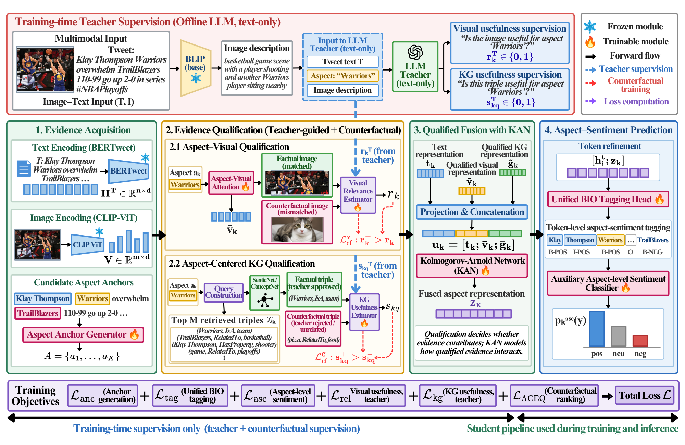

# TARKAN

**Teacher-Guided Aspect-Relevant Knowledge Fusion with KAN for Multimodal
Aspect-Based Sentiment Analysis**  
Lipika Dewangan, Udit Senapaty, Chandresh Kumar Maurya.

The manuscript configuration is [configs/information_fusion.yaml](configs/information_fusion.yaml).
It targets a **single NVIDIA A100**, and aligns the student architecture and
training objective with the supplied final TARKAN manuscript.



## Model and objective

| Component | Manuscript profile |
|---|---|
| Text | Frozen `vinai/bertweet-base` |
| Image | Frozen `openai/clip-vit-base-patch32` |
| Offline teacher | `meta-llama/Meta-Llama-3-8B-Instruct`, **8-bit**, deterministic decoding |
| Teacher image descriptions | `Salesforce/blip-image-captioning-base` |
| Student image concepts | CLIP-ranked KG concepts; no BLIP at inference |
| Fusion | Two B-spline KAN layers, hidden width 256, grid 5, order 3 |
| Optimization | AdamW, LR 2e-5, batch 16, dropout 0.3 |
| Stopping | Maximum 10 epochs, patience 3 on development joint F1 |
| Hardware | NVIDIA A100 (checked at runtime) |

The complete objective (Eq. 24) is:

```text
L = L_tag + 0.3 L_anc + 0.5 L_asc + 0.5 L_rel + 0.3 L_kg + 0.3 L_ACEQ
```

The preliminary aspect-only anchor head is trained by `L_anc`. Predicted anchors
are matched one-to-one to gold training aspects in descending token IoU, with
threshold 0.5. Only matched anchors receive cached evidence labels and auxiliary
sentiment labels. The linear ASC head (Eqs. 22-23) supervises fused aspect
representations during training.

ACEQ ranks useful evidence above mismatched evidence: another image in the
minibatch, or a teacher-rejected triple for the same aspect. When no rejected
triple is available, a different triple from another aspect is re-scored against
the current aspect. Unknown labels are masked. Singleton or duplicate-image
batches skip unavailable visual counterfactuals.

**Inference is student-only unified BIO prediction:** encode the pair, predict
anchors, retrieve and qualify evidence, fuse with KAN, and decode the final
seven-class BIO sequence. There is one final BIO prediction, with no auxiliary
ASC polarity replacement, CRF, teacher, BLIP, or ACEQ construction. MATE ignores
sentiment suffixes; MASC is a separately reported gold-anchor diagnostic.

## Setup and run

Use Python 3.11 on an A100 Linux machine with a compatible CUDA driver:

```bash
python -m venv .venv
source .venv/bin/activate
python -m pip install torch==2.5.1 --index-url https://download.pytorch.org/whl/cu121
python -m pip install -r requirements.txt
python -m spacy download en_core_web_sm
cp .env.example .env.local
# Set HF_TOKEN with access to the Meta Llama 3 checkpoint.
python -m unittest discover -s tests -v
```

Place Twitter-2015/2017 train/dev/test files and images under `data/` as described
in [the reproducibility guide](docs/reproducibility.md). Supply normalized
ConceptNet 5.7 and SenticNet 7 resources, then run:

```bash
python prepare.py kg --triples data/kg_triples.jsonl
python prepare.py concepts --dataset twitter2015
python prepare.py teacher --dataset twitter2015
python train.py --config configs/information_fusion.yaml --dataset twitter2015 --seed 42
python evaluate.py --checkpoint results/twitter2015/full/seed_42/best.pt --output results/twitter2015/full/seed_42/test.json
```

Repeat preparation for Twitter-2017. Run each dataset with seeds **42, 43, 44**;
these are explicit reproduction choices because the paper states three runs but
does not identify the historical seeds. Checkpoints include configuration; each
run writes `manifest.json`, `history.json`, and `best.pt`. Evaluation reloads
the saved configuration and the same KG/concept inputs.

Ablations are explicit, for example:

```bash
python train.py --dataset twitter2015 --seed 42 --ablation no_teacher
python train.py --dataset twitter2015 --seed 42 --ablation no_aceq
python train.py --dataset twitter2015 --seed 42 --ablation mlp_fusion
```

## Reproducibility status

The regression suite covers losses, masks, frozen backbones, IoU matching,
student-only inference, KG counterfactuals, configuration, and a synthetic
training/evaluation/checkpoint cycle. See [validation details](docs/validation.md).

**The manuscript's numerical tables have not been reproduced by this repair.**
Archived checkpoints, original seeds/logs, dataset snapshots, and original
teacher caches were not supplied. The pinned environment is a proposed
reproduction environment, not a claim about historical experiments.
[The issue-resolution record](docs/issue-resolution.md) distinguishes code fixes
from the remaining empirical verification.

Alternative fusion backends, Numberbatch embeddings, and evidence dropout are
experimental options. They are disabled in the manuscript profile. Unsupported
legacy CRF and alternate sentiment-head switches are rejected rather than
silently changing the model.

